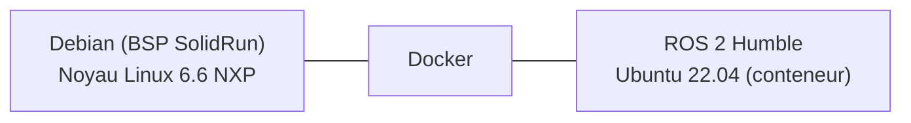

# Installation de l'architecture sur la HummingBoard NXP

Cette documentation décrit comment installer, à partir d'une carte microSD vierge,
l'environnement logiciel utilisé sur la **HummingBoard 8P Edge AI**
(SoC NXP i.MX8M Plus).

## Architecture installée

| Couche | Rôle |
|---|---|
| **Debian (BSP SolidRun)** | Système de base généré avec les scripts SolidRun : noyau Linux 6.6 et drivers de l'i.MX8M Plus |
| **Docker** | Exécution de conteneurs isolés sur la carte |
| **Ubuntu 22.04 + ROS 2 Humble** | Environnement du projet, dans un conteneur qui partage le noyau (et donc les drivers) de Debian |

## Étapes d'installation

1. [Génération et installation de l'image](01_generation_image.md) : construire l'image Debian sur un PC et la flasher sur la microSD
2. [Connexion réseau (Wi-Fi)](02_reseau.md) : connecter la carte à Internet via eduroam
3. [Docker et ROS 2](03_docker_ros2.md) : installer Docker et créer le conteneur pour lancer ROS 2

## Matériel nécessaire

- Une carte HummingBoard 8P Edge AI
- Une Carte microSD
- Un Câble micro-USB pour la visualisation sur consôle série
- Un PC fonctionnant sous un système Linux avec Docker